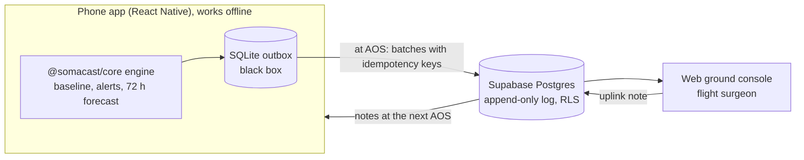

# Somacast

**Body weather for crews beyond Earth.**

Somacast learns each crew member's own normal, forecasts the next 72 hours as **Clear, Cloudy or Storm** with the reason, keeps a black-box log while the link to Earth is down, and hands the flight surgeon a structured SBAR summary when it returns.

> All vitals in Somacast are **simulated** and labelled as simulated. Somacast is **decision support, not a medical device**: it never diagnoses, and the flight surgeon decides. Every threshold is illustrative, expert review required.

## Architecture



The engine in `packages/core` is plain TypeScript with no network and no LLM. The phone runs it on device; the console runs the same engine in the browser on the synced readings.

## Quick start

Install once:

```bash
(cd packages/core && npm ci)
(cd apps/mobile && npm ci)
(cd apps/web && npm ci)
```

Run from the repo root:

```bash
npm start         # Metro bundler (keep this terminal open)
npm run android   # in a second terminal: build and launch on Android
npm run web       # ground console (needs apps/web/.env, see apps/web/.env.example)
```

On the sign-in screen, **Continue offline** runs the whole phone demo without a backend. React Native commands such as `npx react-native run-android` only work inside `apps/mobile`, not at the repo root.

## How to verify

```bash
npm test            # all automated tests: core (Jest), mobile (Jest), web (Vitest)
npm run rls-check   # live Supabase: 17 checks that each user sees and writes only what RLS allows
```

`rls-check` needs `apps/mobile/.env` (Supabase URL and anon key) and `scripts/.env` (demo passwords); see [supabase/seed-users.md](supabase/seed-users.md). It never uses the service-role key and writes only to the test crew `ZZ-TEST`.

Each requirement, the test or demo step that checks it, and its honest status: [docs/verification.md](docs/verification.md).

## Limitations

What Somacast does not do yet, and where every number comes from: [docs/limitations.md](docs/limitations.md) and [docs/data-sources.md](docs/data-sources.md).

## Earth mode

A **Space / Earth** switch on the phone (Today screen) and in the console header rewords the app for a remote team on Earth: LOS becomes "Offline", flight surgeon becomes "remote doctor". Alert reasons, forecasts, coach actions and the handoff are re-worded on screen too; the logic and the stored log do not change. Each device remembers the choice. See [docs/earth-mode.md](docs/earth-mode.md).

## Project structure

```
packages/core/src/          Pure TypeScript, shared by mobile and web
  domain/                   Metrics catalogue and Zod schemas (reading, alert, forecast, handoff)
  simulation/               Seeded simulator and scenarios (all data simulated)
  engine/                   Baseline, z-score anomalies, 72 h forecast (rules only)
  coach/                    Crew actions and the SBAR handoff (rules only)
  sync/                     Black-box outbox and idempotent sync
  copy/                     Space / Earth wording, and engine sentences written by mode
  design/                   Brand tokens and contrast check
  index.ts                  Public API; apps import only from here

apps/mobile/src/            React Native app, feature-first (model / controller / view)
  app/                      App root (providers, sign-in gate)
  features/                 today, link (LOS/AOS, sync), ground (handoff, notes), auth
  shared/                   Components, theme, Space / Earth wording
  sync/                     SQLite outbox and Supabase transport

apps/web/src/               Ground console for flight surgeons (React + Vite), see apps/web/README.md
  data/                     Pure: Supabase rows -> readings -> core assess(); Supabase calls
  features/                 auth, overview (crew cards), crew (handoff, alerts, sparklines, notes)
  shared/                   Shell (SIMULATED DATA badge, footer), weather status, formatting
```

## Docs

[ConOps](docs/conops.md) · [Requirements](docs/requirements.md) · [Engine](docs/engine.md) · [Verification](docs/verification.md) · [Limitations](docs/limitations.md) · [Data sources](docs/data-sources.md) · [Earth mode](docs/earth-mode.md) · [Demo script](docs/demo-script.md) · [Submission draft](docs/submission-draft.md)

---

Somacast is an independent team project for the NASA Space Apps Challenge. It is not affiliated with or endorsed by NASA.
