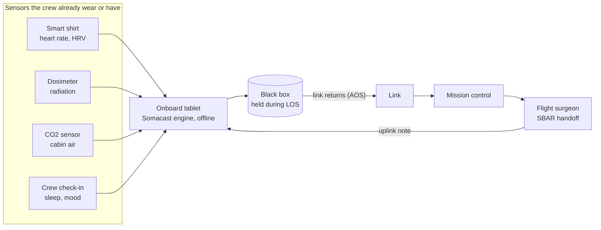

# Demo vs real mission

Somacast is not a sensor. It is the brain on top of the sensors crews already wear: it works offline, knows each person's normal, and hands the doctor a structured report when the link returns.

The demo swaps every outside piece for a stand-in we can run for free. The engine is the one part that stays exactly the same.

## What changes and what does not

| Part | In this demo | In a real mission |
| --- | --- | --- |
| Data source | Seeded simulator, or the bundled example CSV (`samples/wearable-export-example.csv`, values made up). Every reading carries its `source`, and the badge on screen says which. | Crew wearables and cabin sensors, each behind its own `ReadingSource` adapter. Not built: no real device is connected today. |
| Where the app runs | Android phone or emulator (React Native) | An onboard crew tablet running the same app |
| Link | A LOS/AOS switch on the phone that simulates blackouts | The spacecraft's communication link, with delay and blackouts |
| Ground server | Supabase free tier (Postgres, auth, row-level security) | Mission control's own ground systems (an assumption; not designed) |
| Doctor screen | Web ground console (React + Vite) | The flight surgeon's console in mission control |
| Engine | `@somacast/core`: baseline, alerts, 72 h forecast, SBAR handoff | **Same.** No change. |

## The flow in a real mission



## Real crew wearables exist

The Canadian Space Agency's **Bio-Monitor** is an example of a real crew wearable that records vital signs, with the data downloaded to Earth later: <https://www.csa-asc.gc.ca/eng/sciences/astroskin.asp>.

Somacast has **no integration** with Bio-Monitor or any other device. It is named only to show the kind of source a real mission could plug into the `ReadingSource` socket.

## The plug socket: `ReadingSource`

Every source hands the engine the same thing, a list of daily readings (`packages/core/src/sources/readingSource.ts`):

```ts
interface ReadingSource {
  id: string;
  label: string;
  kind: 'simulated' | 'imported' | 'manual' | 'device';
  load(crewId: string): Promise<DailyReading[]>;
}
```

| Source | File | Status |
| --- | --- | --- |
| `SimulatorSource` | `packages/core/src/sources/simulatorSource.ts` | Built. Wraps the seeded simulator; same readings as before. |
| `CsvImportSource` | `packages/core/src/sources/csvImportSource.ts` | Built. Reads the CSV format below. |
| Manual entry | none | Not built |
| A device | none | Not built |

A test checks the claim directly: the same numbers from the simulator and from a CSV give exactly the same alerts and forecast (`packages/core/src/sources/sources.test.ts`).

On the phone, the **Data source** selector (offline demo only) switches between **Simulated** and **Import CSV**. Import reads the example file shipped inside the app, so no file picker is needed. Signed-in demo accounts stay on simulated data, so only simulated readings reach the real ground console.

## CSV format

One row per crew member per day:

```text
date,crewId,restingHr,hrv,sleepHours,exerciseMin,cabinCo2,radiationDose,psychCheckin
2027-03-01,EX1,60,64,6.6,118,2.1,0.46,5
```

| Column | Unit |
| --- | --- |
| `date` | YYYY-MM-DD, a real calendar day |
| `crewId` | any non-empty id |
| `restingHr` | bpm |
| `hrv` | ms (rMSSD) |
| `sleepHours` | h |
| `exerciseMin` | min/day |
| `cabinCo2` | mmHg |
| `radiationDose` | mSv/day |
| `psychCheckin` | whole number 1 to 5 (5 is best) |

Rules:

- Plain comma-separated values: no quotes and no commas inside a field.
- Lines starting with `#` are comments, and blank lines are skipped.
- The header must name every column above, in any order. Extra columns are ignored. A header with a missing column rejects the whole file.
- Each row is checked with the same Zod schema as every other reading (`ReadingSchema`). A bad row (not a number, out of range, wrong field count, not a real date, the same crew and date twice) is **reported with its line number and left out**. The rest of the file still loads.
- Day 0 is the earliest valid date in the file. A missing date stays a gap; it is not filled in.
- Every imported reading is marked `source: 'imported'`, and the handoff says "All vitals were imported from a data file." instead of "simulated".
